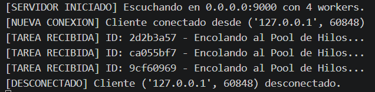
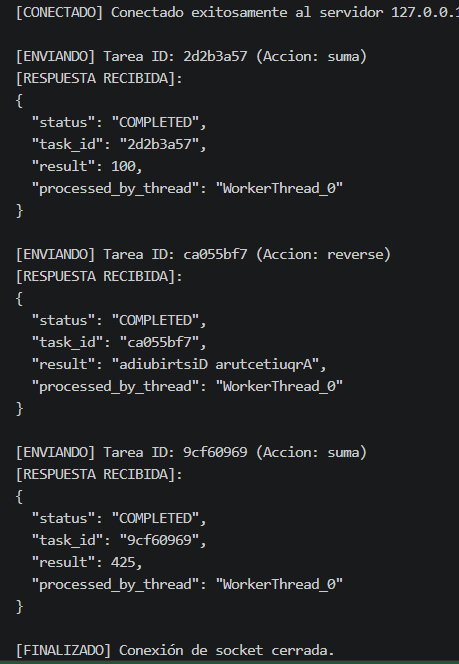
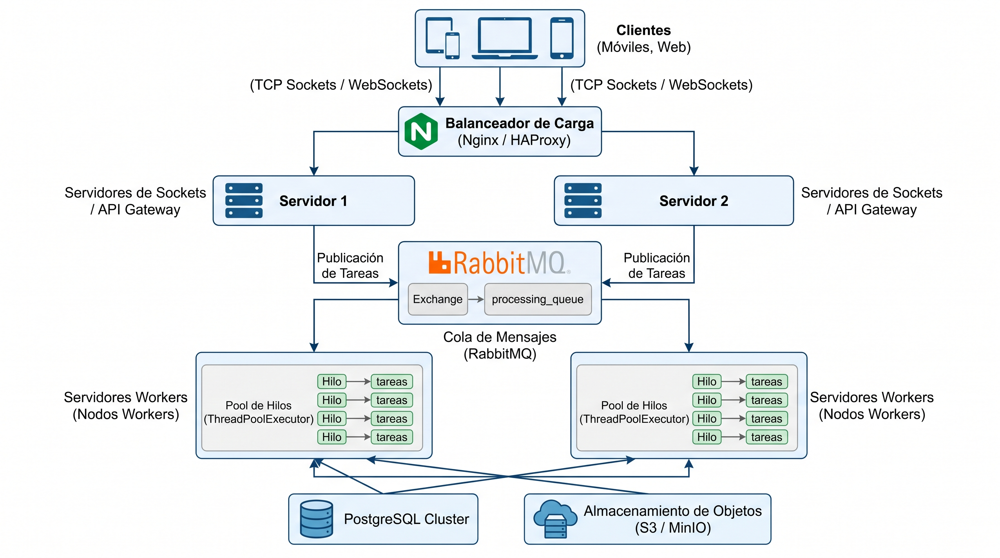

# Sistema distribuido de procesamiento de tareas

Aplicación en Python que implementa un servidor TCP capaz de recibir
tareas en formato JSON y devolver sus resultados a un cliente. El servidor
utiliza hilos para atender conexiones y un pool de hasta cuatro workers para
procesar las tareas.

## Requisitos

- Python 3.8 o superior.
- No se necesitan paquetes externos: el proyecto utiliza únicamente la
  biblioteca estándar de Python.

## Archivos

- `servidor.py`: inicia el servidor TCP en el puerto `9000`.
- `cliente.py`: se conecta al servidor y envía un lote de tres tareas de ejemplo.
- `diagrama-Arquitectura-Sistema-Distribuido.jpg`: diagrama de arquitectura.

## Ejecución

En una terminal, inicia el servidor:

```bash
python3 servidor.py
```

En otra terminal, desde la misma carpeta, ejecuta el cliente:

```bash
python3 cliente.py
```

Detén el servidor con `Ctrl+C`.

## Protocolo y tareas

La comunicación utiliza TCP. Cada mensaje es un objeto JSON en una línea,
delimitado por un salto de línea (`\n`). Una solicitud tiene esta estructura:

```json
{
  "id": "identificador-de-tarea",
  "action": "suma",
  "payload": {
    "numeros": [10, 20, 30]
  }
}
```

Acciones implementadas:

| Acción | Datos de `payload` | Resultado |
| --- | --- | --- |
| `suma` | `numeros`: lista de números | Suma de los elementos |
| `reverse` | `text`: texto | Texto invertido |

El servidor responde también con una línea JSON. La respuesta incluye el estado,
el identificador de tarea, el resultado y el nombre del hilo que procesó la
tarea. Por ejemplo:

```json
{
  "status": "COMPLETED",
  "task_id": "identificador-de-tarea",
  "result": 60,
  "processed_by_thread": "WorkerThread_0"
}
```

Cada tarea simula el procesamiento durante aproximadamente 1,5 segundos.

## Capturas del proceso

### Servidor



### Cliente


## Diagrama

